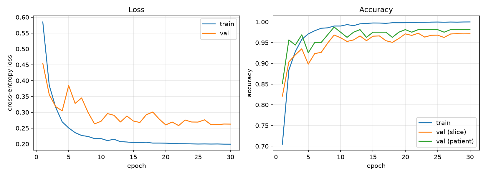
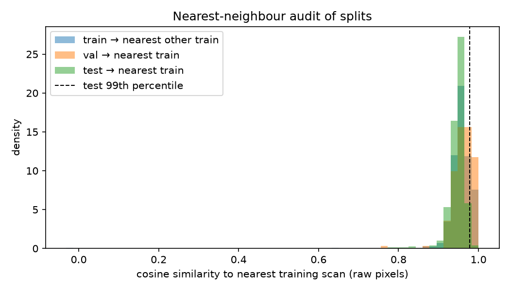
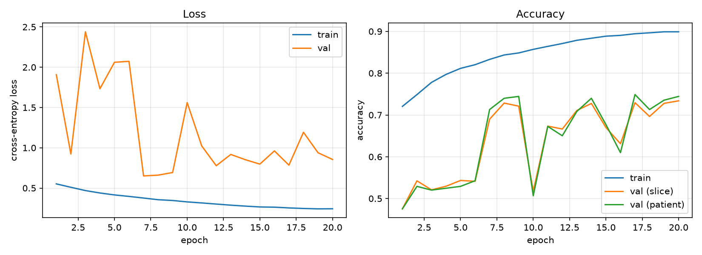
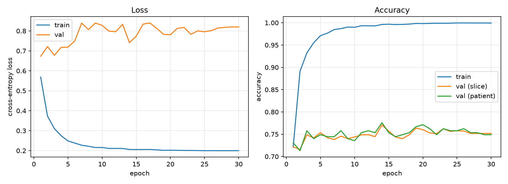
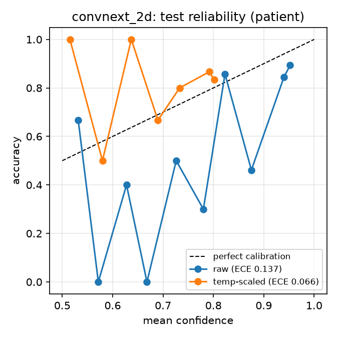
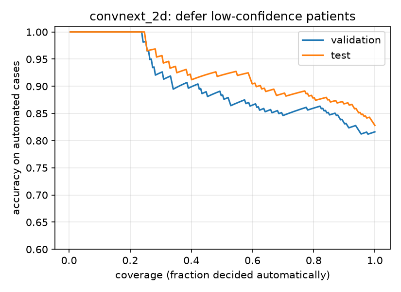
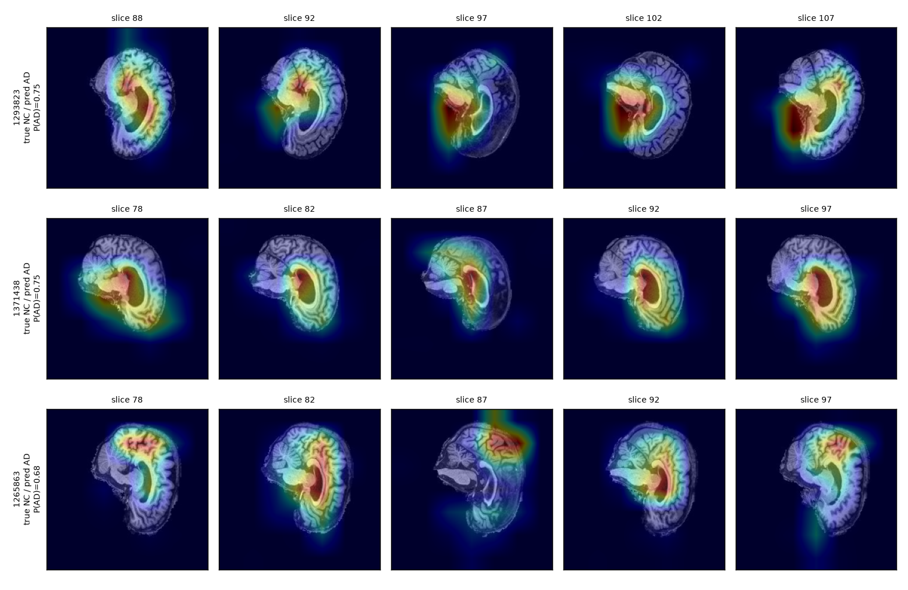
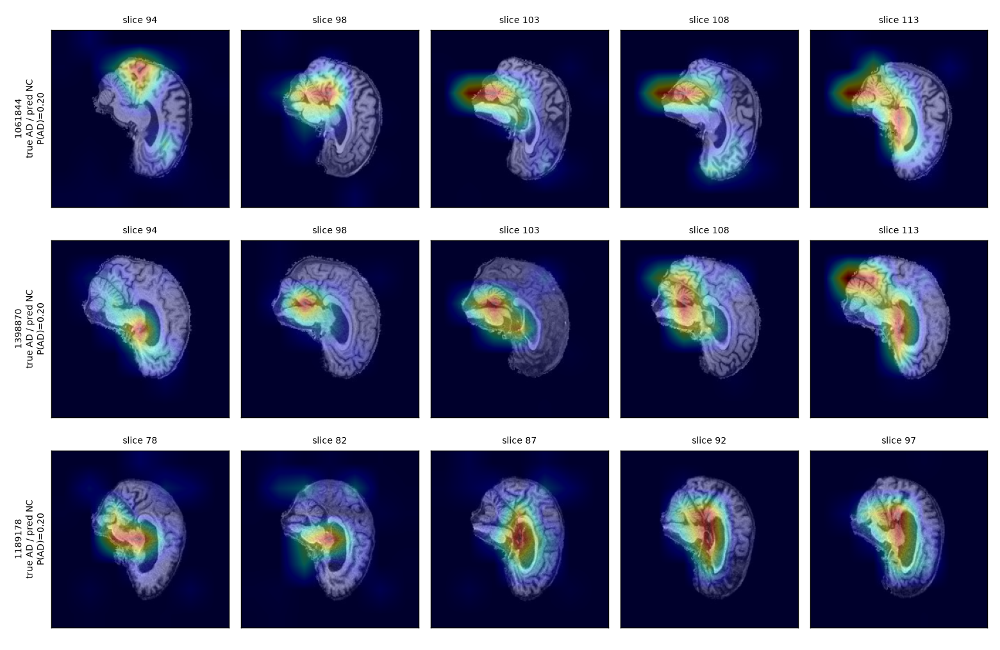
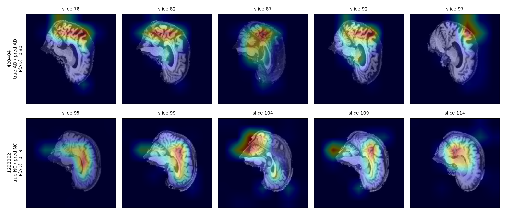

# Alzheimer's Disease Classification from Brain MRI with ConvNeXt

**COMP3710 Pattern Recognition Report 2026 — Classification (Hard): ConvNeXt on ADNI**
Author: s4906926

> **Summary.** A ConvNeXt-T network, implemented from scratch in PyTorch and initialised from ImageNet-1k weights, classifies T1-weighted brain MRI scans as Alzheimer's disease (AD) or cognitively normal (NC). On a held-out, subject-disjoint test set of 227 scans it reaches **82.8 % patient-level accuracy** (95 % CI 78.0–87.7 %), **AUROC 0.892**, and **80.2 % sensitivity**, compared with 75.3 % accuracy and 0.850 AUROC for a plain CNN baseline. While building it we found that a validation set carved from the official training folder **leaks subjects** (validation accuracy 0.98 against test 0.75). We confirmed the leak with a model-free nearest-neighbour audit and rebuilt the evaluation protocol to remove it. The report closes with a calibrated deferral rule and a deployment recommendation.


---

## Contents

1. [Problem and algorithm](#1-problem-and-algorithm)
2. [Feasibility review (midpoint)](#2-feasibility-review-midpoint)
3. [Data, pre-processing and splits](#3-data-pre-processing-and-splits)
4. [Discovering and fixing subject leakage](#4-discovering-and-fixing-subject-leakage)
5. [Training](#5-training)
6. [Results: ConvNeXt vs baseline](#6-results-convnext-vs-baseline)
7. [The open research dilemma: confidence, calibration and deferral](#7-the-open-research-dilemma-confidence-calibration-and-deferral)
8. [Failure case autopsy](#8-failure-case-autopsy)
9. [Recommendation to the project manager](#9-recommendation-to-the-project-manager)
10. [Usage](#10-usage)
11. [Dependencies and reproducibility](#11-dependencies-and-reproducibility)
12. [Limitations and future work](#12-limitations-and-future-work)
13. [Artificial Intelligence Usage Disclosure](#13-artificial-intelligence-usage-disclosure)
14. [References](#14-references)

---

## 1. Problem and algorithm

### The problem

Alzheimer's disease causes progressive neurodegeneration that appears on structural MRI as hippocampal and cortical atrophy and ventricular enlargement. An automated classifier could help clinicians screen scans. Two things make it hard. First, the signs of AD overlap with normal ageing and with natural variation between heads. Second, each scan contributes many highly correlated slices, so any split that is not done at the subject level leaks information. The task here is binary classification of ADNI scans into **AD** vs **NC** (cognitively normal), with a course target of **≥ 0.8 test accuracy**.

### How it works

Each scan in the provided dataset is a stack of 20 sagittal 2-D slices. The model processes every slice independently:

1. **Patchify stem.** A 4×4 convolution with stride 4 splits the 224×224 slice into non-overlapping patches, followed by LayerNorm.
2. **Four stages of ConvNeXt blocks** (3, 3, 9 and 3 blocks; 96 → 768 channels). Each block is an *inverted bottleneck*: a 7×7 **depthwise** convolution (large receptive field, spatial mixing), then LayerNorm, a 1×1 expansion to 4C, GELU, and a 1×1 projection back to C. A learnable per-channel **Layer Scale** and **stochastic depth** (DropPath) are applied before the residual addition. Between stages, a LayerNorm and a 2×2 stride-2 convolution halve the resolution.
3. **Head.** Global average pooling, LayerNorm and a linear layer produce two logits per slice.
4. **Patient-level decision.** Slice logits are divided by a temperature *T* fitted on the validation set, converted to P(AD), and averaged over the 20 slices of the scan. The averaged P(AD) is compared with a threshold chosen on validation. Scans whose probability lies close to the threshold can be **deferred** to a clinician (Section 7).

ConvNeXt (Liu et al., 2022) "modernises" a ResNet with design choices borrowed from Vision Transformers: patchify stem, large kernels, inverted bottleneck, LayerNorm and GELU, and fewer normalisation and activation layers. The architecture is **implemented from scratch** in [`modules.py`](modules.py). Pretrained ImageNet-1k weights are loaded into this implementation for transfer learning. Because MRI is single-channel, the RGB stem filters are summed over the colour axis, which is mathematically equivalent to feeding the grey image as (x, x, x).

**Implementation check.** Given identical weights, our implementation and the reference `timm` ConvNeXt-T produce outputs whose maximum absolute difference is **0.0**. The single-channel stem matches the RGB model fed (x, x, x) to within 1.4 × 10⁻⁶ (floating-point error).

---

## 2. Feasibility review (midpoint)

*Written at the project midpoint, after the data audit and baseline experiment and before the advanced model was trained. Outcomes against each criterion are added in the right-hand column.*

**User need and scope.** The intended user is a radiology or memory-clinic team that wants a *decision-support* triage tool. The tool should flag scans likely to show AD and route ambiguous scans for expert reading. It is not an autonomous diagnostic device. The prototype classifies preprocessed ADNI T1 slices as AD or NC at the patient (scan) level.

**Acceptance criteria**

| # | Criterion | Outcome (final model) |
|---|---|---|
| AC1 | Patient-level test accuracy ≥ 0.80 on a **subject-disjoint** held-out set | ✅ 0.828 (95 % CI 0.780–0.877; lower bound below 0.80) |
| AC2 | AUROC ≥ 0.85 and AD sensitivity ≥ 0.80 at the deployed operating point (a missed AD case costs more than a false alarm) | ✅ AUROC 0.892, sensitivity 0.802 |
| AC3 | Calibrated confidence: patient-level ECE ≤ 0.10, and a deferral rule giving ≥ 85 % accuracy on automated cases while deferring ≤ 25 % | ✅ ECE 0.066; 13.7 % deferred → 87.2 % accuracy |
| AC4 | Resources: training ≤ 1 GPU-hour on one A100, peak training VRAM ≤ 16 GB, inference ≤ 100 ms per patient | ✅ ~12 min, 4.3 GB, 28.8 ms |
| AC5 | No subject overlap between training and evaluation data, **verified empirically**, not just assumed | ✅ after the fix in Section 4 |

**Model choice and course concepts.** ConvNeXt-T (Hard band) was chosen because it is a modern CNN whose design rationale (Liu et al., 2022) can be explained step by step from ResNet, and because ImageNet transfer learning is well established for small medical datasets. The baseline is a 4-stage plain CNN (Conv–BN–ReLU–MaxPool, 0.39 M parameters). Patient-level aggregation of slice probabilities uses the multi-slice structure of the data.

**Preliminary evidence.**
* *Data audit:* official train folder has 1,076 scan IDs (AD 520, NC 556) and test folder 450 (AD 223, NC 227). Every scan has exactly 20 slices, and the classes are balanced (~48 % AD), so accuracy is a meaningful headline metric.
* *Baseline:* the CNN trained in ~5 min on one A100 (2.1 GB peak VRAM), and patient-level averaging improved test accuracy from 0.731 to 0.749. So the pipeline works end to end, and aggregation helps.
* *Warning sign:* the baseline's validation accuracy (0.93, scans carved from the train folder) was **18 points higher** than its test accuracy (0.75). This was flagged as a probable leakage problem to investigate before trusting any model selection.

**Risks, budget and fallback.**
* *Risk 1, hidden subject leakage* (ADNI is longitudinal). Mitigation: a model-free similarity audit of the splits (planned next experiment).
* *Risk 2, 0.8 not reached with 2-D slices.* Mitigations: transfer learning, patient-level aggregation, a validation-tuned threshold, and 2.5-D input.
* *Risk 3, overconfidence.* Mitigation: temperature scaling and a reject option.
* *Budget:* about 10 A100 GPU-hours on the `comp3710` partition (≤ 1 h per run).
* *Fallback:* if ConvNeXt does not beat the baseline on an honest split, report the negative result together with the leakage analysis, and use a frozen-backbone ConvNeXt as a cheaper alternative.

---

## 3. Data, pre-processing and splits

**Dataset.** Preprocessed ADNI slices from Rangpur at `/home/groups/comp3710/ADNI/AD_NC/{train,test}/{AD,NC}/`. File names are `<scanID>_<sliceIndex>.jpeg`, and each scan has 20 consecutive sagittal slices. The starting slice index varies between scans, mostly 75, 78, 88, 94 or 95.

**Pre-processing** ([`dataset.py`](dataset.py)):
* Images are loaded as grey-scale and resized to 224×224.
* Intensities are standardised with a mean and standard deviation estimated from 2,000 random **training** images only. Using validation or test statistics would leak information.
* Training augmentation: horizontal flip (the brain is roughly left–right symmetric) and a small random affine transform (±10°, ±5 % translation, 0.95–1.05 scale). A stronger variant (`--aug strong`) adds larger affine transforms, brightness/contrast jitter and random erasing.
* Validation and test images are not augmented.

**Final split** (`--split official`, the default):

| Split | Source | Scans (AD / NC) | Slices |
|---|---|---|---|
| Train | entire official `train/` folder | 1,076 (520 / 556) | 21,520 |
| Validation | half of official `test/` folder, grouped by subject, stratified | 223 (107 / 116) | 4,460 |
| Test (held out) | other half of official `test/` folder | 227 (116 / 111) | 4,540 |

**Why not take validation from the training folder?** Section 4 shows that the official training folder contains repeat scans of the same subjects under different scan IDs. A validation set drawn from it therefore shares subjects with the training set. The official train and test folders, by contrast, appear subject-disjoint: test scans have no near-duplicates in the training folder (1-NN label agreement 57 %, close to chance), and once validation was taken from the test folder, validation and test accuracy agreed (Section 4). Splitting the test folder in half therefore gives a validation set that comes from the same distribution as the test set and shares no subjects with training. The test half is used once, only for the final numbers. Before halving, near-duplicate scan IDs inside the test folder are merged into groups ([`splits/test_groups.json`](splits/test_groups.json)) so that both halves never contain the same scan twice. Splits are deterministic (seed 42), and [`check_split.py`](check_split.py) verifies that scan-ID and subject-group overlap is zero for every pair of splits.

---

## 4. Discovering and fixing subject leakage

This was the most consequential finding of the project.

### Symptom

With the conventional approach (15 % of the training folder held out as validation, split by scan ID), both models looked excellent on validation and much worse on test. The larger model showed the larger gap:

| Split protocol | Model | Val patient acc | Test patient acc | Gap |
|---|---|---|---|---|
| Val from train folder (by scan ID) | Baseline CNN | 0.932 | 0.749 | −18 pts |
| Val from train folder (by scan ID) | ConvNeXt-T | 0.981 | 0.736 | −25 pts |
| Val from train folder, near-duplicates grouped | Baseline CNN | 0.905 | 0.751 | −15 pts |
| Val from train folder, near-duplicates grouped | ConvNeXt-T | **0.994** | 0.747 | **−25 pts** |
| **Val from test folder (final)** | Baseline CNN | 0.740 | 0.753 | ≈ 0 |
| **Val from test folder (final)** | ConvNeXt-T | 0.776 | 0.771 | ≈ 0 |

*(Accuracies at threshold 0.5. In the first four rows the test set is the full 450-scan test folder; in the last two it is the 227-scan held-out half.)*

Even with near-duplicates grouped, ConvNeXt reached 0.93 patient accuracy on validation after a **single epoch**, while its training accuracy was still 0.70, and it finished training above 99.9 % training accuracy. Together these point to a model that recognises *individuals* rather than disease.


*ConvNeXt-T trained with validation taken from the training folder: validation accuracy (~0.97) is meaningless; the same model scores 0.74 on test.*

### Model-free evidence: nearest-neighbour audit

[`audit_split.py`](audit_split.py) builds a fingerprint for each scan (all 20 slices at 32×32, zero-mean, unit norm). For every validation and test scan it finds the most similar **training** scan by cosine similarity. No model is involved.

| Query → nearest train scan | Share above test-p99 similarity (0.978) | 1-NN label agreement |
|---|---|---|
| train → other train | 19.3 % | 76.3 % |
| **val (from train folder) → train** | **31.1 %** | **78.9 %** |
| test → train | 1.1 % | 57.3 % |

* **31 %** of validation scans had a training scan more similar than 99 % of test scans do. The most similar pairs reached a cosine similarity of **0.9995–1.0000** and had **near-consecutive IDs** (e.g. `1037249`/`1037253`, `1029553`/`1029554`), i.e. the same acquisition under two image IDs.
* Copying the label of the most similar training scan (a 1-nearest-neighbour "classifier" on raw pixels) was right **79 %** of the time on validation but only **57 %** on test, close to chance.



### Why grouping near-duplicates was not enough

Merging scan IDs with similarity above 0.978 (union–find; at most 5 scan IDs per group) removed exact re-exports, but ConvNeXt's validation accuracy stayed at 0.99. ADNI is longitudinal: the same person is rescanned months or years apart. Those scans differ in head pose and degree of atrophy, so their *pixel* similarity is no higher than between two unrelated people, and the audit cannot detect them. A 28 M-parameter network can still recognise the individual from cortical folding and ventricle shape. Because the file names carry no subject identifiers, **this leak cannot be removed from inside the training folder.** The validation set was therefore moved to the subject-disjoint test folder (Section 3). After the change, validation and test accuracy agree to within one point for both models (last two rows of the table above).

---

## 5. Training

[`train.py`](train.py) trains a model, keeps the checkpoint with the best validation accuracy, and evaluates it once on the test set.

| | Baseline CNN | ConvNeXt-T (final) |
|---|---|---|
| Initialisation | random | ImageNet-1k (official checkpoint) |
| Optimiser | AdamW, lr 1e-3, wd 1e-4 | AdamW, lr 1e-4, wd 0.05 (no decay on biases, norms, Layer Scale) |
| Schedule | cosine | 3-epoch linear warm-up + cosine (per iteration) |
| Epochs / batch | 20 / 64 | 30 / 64 |
| Regularisation | dropout 0.3 | label smoothing 0.1, DropPath 0.1 |
| Precision | bfloat16 autocast | bfloat16 autocast |
| Best epoch (by val) | 20 | 14 |
| Time per epoch (A100) | ~15 s | ~24 s |

<p float="left">
  
  
</p>

*Left: baseline. Right: ConvNeXt-T, final split.* ConvNeXt's validation curve is much smoother than the baseline's. The baseline's validation accuracy collapses repeatedly to ~0.5 (all one class), which is consistent with BatchNorm running statistics lagging behind fast weight updates at lr 1e-3; ConvNeXt has no BatchNorm. ConvNeXt still overfits: training accuracy approaches 0.999, while validation accuracy peaks at epoch 14 and does not improve afterwards. This is why the best-validation checkpoint is used.

---

## 6. Results: ConvNeXt vs baseline

All numbers below come from [`predict.py`](predict.py) on the **same** held-out test set of 227 scans. The temperature and decision threshold are fitted on validation only. 95 % confidence intervals are percentile bootstrap over patients (1,000 resamples).

### Main comparison (patient level, threshold chosen on validation)

| Metric | Baseline CNN | **ConvNeXt-T** |
|---|---|---|
| Accuracy | 0.753 [0.692, 0.806] | **0.828 [0.780, 0.877]** |
| AUROC | 0.850 | **0.892** [0.847, 0.930] |
| Macro-F1 | 0.752 | **0.828** |
| AD recall (sensitivity) | 0.681 | **0.802** |
| AD precision | 0.806 | **0.853** |
| NC recall (specificity) | 0.829 | **0.856** |
| NC precision | 0.713 | **0.805** |
| Confusion (TP / FN / FP / TN) | 79 / 37 / 19 / 92 | 93 / 23 / 16 / 95 |
| Slice-level accuracy / AUROC (@0.5) | 0.742 / 0.827 | 0.781 / 0.829 |

ConvNeXt is better on every metric. Its accuracy interval only slightly overlaps the baseline's, and its AUROC gain (+0.04) is the more robust signal. With 227 test patients, the lower bound of ConvNeXt's accuracy interval (0.780) sits below the 0.8 target, so we report the target as met in point estimate, not with certainty.

### The decision threshold matters

At the default threshold of 0.5, ConvNeXt reaches only 0.771 accuracy because it is **biased towards NC**: sensitivity 0.586, specificity 0.964, i.e. 41 % of AD patients missed. The threshold chosen on validation (0.252, maximising balanced accuracy) restores the balance (sensitivity 0.802, specificity 0.856) without using the test set. The baseline is less biased (its validation threshold is 0.448), so the same procedure gives it no gain.

### Resource profile

| | Baseline CNN | ConvNeXt-T |
|---|---|---|
| Trainable parameters | 388,834 | 27,818,594 (×72) |
| Peak GPU memory, training (batch 64, bf16) | 2.1 GB | 4.3 GB |
| Peak GPU memory, inference (batch 64) | 0.79 GB | 1.04 GB |
| Inference latency, 1 slice | 0.7 ms | 4.4 ms |
| Inference latency, 1 patient (20 slices) | 2.4 ms | 28.8 ms (×12) |
| Training time | ~5 min | ~12 min |

*(NVIDIA A100-PCIE-40GB; latency is the mean of 50 forward passes after warm-up.)*

### Other variants (negative or inconclusive results)

| Variant | Val AUROC | Test acc [95 % CI] | Test AUROC | Note |
|---|---|---|---|---|
| ConvNeXt-T, 2-D (**final**) | 0.868 | 0.828 [0.780, 0.877] | 0.892 | |
| ConvNeXt-T, 2.5-D (slices s−1, s, s+1 as RGB) | 0.869 | 0.815 [0.767, 0.863] | 0.874 | 2× training time, no gain |
| + strong aug, mixup 0.2, DropPath 0.3, 15 epochs | 0.846 | 0.846 [0.802, 0.894] | 0.908 | better on test, worse on val |
| same, lr 5e-5, early stopping | 0.837 | 0.819 [0.767, 0.868] | 0.912 | |

**Model selection.** The selection criterion was fixed in advance: validation patient-level AUROC, with the test set never used. 2-D and 2.5-D ConvNeXt are tied on validation (0.868 vs 0.869). We keep the 2-D model because it is simpler and trains twice as fast. The regularised variants rank *lower* on validation but *higher* on test. With about 225 patients per split, these differences are within sampling noise, so we do not claim that regularisation helped. Picking the best test score (0.846) instead would be test-set selection.

---

## 7. The open research dilemma: confidence, calibration and deferral

*Does the model know when it is wrong, and can low-confidence cases be routed safely to a clinician?*

### Calibration

Both models are **overconfident** before calibration. The fitted temperatures are T = 3.26 (baseline) and T = 2.18 (ConvNeXt); a perfectly calibrated model would have T = 1.

| | ECE before | ECE after temperature scaling |
|---|---|---|
| Baseline | 0.101 | 0.072 |
| ConvNeXt-T | 0.137 | **0.066** |



*Patient-level reliability on test. Before scaling (blue), most bins lie below the diagonal: the model claims more certainty than it delivers. With 227 patients over 10 bins some bins hold only a handful of patients, so individual points are noisy.*

### Selective prediction (reject option)

Each patient's confidence is its normalised distance from the threshold. On **validation** we choose the smallest confidence cut-off that achieves a target accuracy on the retained (automated) patients, then apply that cut-off unchanged to **test**:

| Target accuracy on automated cases | Baseline: deferred → automated acc | **ConvNeXt: deferred → automated acc** |
|---|---|---|
| 85 % | 59.5 % → 0.902 | **13.7 % → 0.872** |
| 90 % | 75.8 % → 0.945 | **55.1 % → 0.922** |



* The **24 % most confident** ConvNeXt predictions on test were all correct.
* To reach 85 % accuracy on automated cases, ConvNeXt sends **about 4× fewer patients** to clinicians than the baseline (13.7 % vs 59.5 %). This is the operational argument for the larger model.
* The validation and test curves have the same shape, so a cut-off chosen on validation transfers to test.

### Where confidence fails: label-smoothing saturation

Label smoothing (0.1) trains the network towards targets of 0.95/0.05, so its outputs saturate there. The final training loss, 0.199, equals the entropy of a (0.95, 0.05) distribution, 0.1985. After temperature scaling, the most confident NC output corresponds to **P(AD) ≈ 0.20**. The three most confident missed AD patients (Section 8) sit **exactly on this floor**: the model was as sure as it can ever be that they were healthy. **Confidence-based deferral therefore does not catch the most confident misses.** The same compression puts every calibrated probability in about [0.2, 0.8] and places the threshold (0.252) just above the floor, which makes the confidence scale on the NC side very narrow. This interaction between label smoothing and post-hoc calibration is consistent with Müller et al. (2019). It is a concrete reason to retrain without label smoothing before deployment (Section 9).

---

## 8. Failure case autopsy

[`predict.py`](predict.py) selects the most confident false positives and false negatives on test and overlays **Grad-CAM** (Selvaraju et al., 2017) from the last ConvNeXt stage on five slices spread across each scan. Grad-CAM at 7×7 resolution localises regions only coarsely, not individual structures such as the hippocampus.

### False positives (NC predicted as AD)



| Scan | P(AD) | Grad-CAM focus | Diagnosis |
|---|---|---|---|
| 1371438 | 0.75 | lateral ventricles, consistently across slices | **Ageing mimics AD.** Enlarged ventricles are a classic AD marker but also occur in healthy older adults; without age information a single slice cannot separate the two. |
| 1265863 | 0.68 | widened parietal sulci; at slice 87 attention extends **outside the brain** | Cortical atrophy (also age-related) plus partly spurious evidence. |
| 1293823 | 0.75 | brainstem/cerebellum and **regions outside the brain** in later slices | **Off-target attention.** This scan has a different slice range and head tilt; the evidence used is not AD-related anatomy. |

### False negatives (AD predicted as NC), the clinically dangerous errors



| Scan | P(AD) | Grad-CAM focus | Diagnosis |
|---|---|---|---|
| 1061844 | 0.198 | cerebellum and the area behind it | **Off-target attention** on structures that are not discriminative for AD; cortex and ventricles look relatively preserved in these slices. |
| 1398870 | 0.199 | cerebellum/brainstem; ventricles only in the last slice | Same pattern as 1061844. |
| 1189178 | 0.200 | thalamus and lateral ventricles (appropriate regions) | **Subtle atrophy.** The model looks in the right place but sees only mild enlargement. ADNI diagnoses are clinical; a scan from an AD subject need not show marked atrophy. |

All three sit at the saturation floor described in Section 7, so they are **confident** errors.

### A hypothesis we tested and rejected

Three of the six cases above (1293823, 1061844, 1398870) have a slice range other than the most common one (78–97), and in all three Grad-CAM fell largely on the cerebellum or outside the brain. We hypothesised that scans covering a different part of the brain are more error-prone and tested this on **all** 450 evaluation scans (Fisher's exact test on error counts):

| Split | Standard range (first slice 78) | Other ranges | p |
|---|---|---|---|
| Validation | 0.885 (n = 78) | 0.779 (n = 145) | 0.069 |
| Test | 0.765 (n = 68) | **0.855** (n = 159) | 0.124 |

The effect reverses direction between the two splits and is not significant in either. Slice ranges cluster at five starting indices (75/78/88/94/95), so "non-standard" scans are common, not anomalous. **The hypothesis is not supported.** We include it because it shows that a few saliency maps are not enough evidence for a failure mode. *(Side observation: in the test half, scans starting at slice 78 are 68 % AD, compared with 44 % for the others; in validation both groups are ~49 % AD. Whether acquisition protocol correlates with diagnosis in parts of ADNI, and so offers the model a shortcut, deserves a check with the original metadata.)*

### Failure modes in summary

1. **Ageing vs AD ambiguity.** Real atrophy features such as ventricles and sulci also appear in healthy elderly subjects.
2. **Confident misses caused by output saturation.** These are not caught by deferral.
3. **Off-target evidence.** Attention sometimes falls on the cerebellum or outside the brain.
4. **Imaging-silent AD.** The clinical label is not always visible on the scan.

For contrast, a correctly classified AD scan (attention on parietal sulci) and NC scan (attention around normal-sized ventricles):



---

## 9. Recommendation to the project manager

**Decision: conditional go, as a *rule-in* triage aid, not as a rule-out tool or a diagnostic device.**

1. **What it can do.** On held-out patients the system identifies AD with 80 % sensitivity and 86 % specificity (accuracy 0.83, AUROC 0.89). It is markedly better than the simple baseline (0.75 / 0.85).
2. **Recommended operating point.** Temperature T = 2.18, threshold P(AD) ≥ 0.252, both fitted on validation. Defer scans whose normalised confidence is below 0.105: about **14 % of scans go to a clinician**, and the remaining 86 % are classified with ~87 % accuracy. The most confident quarter of scans was 100 % correct on test.
3. **Use it to prioritise, not to rule out.** False positives are visible and inexpensive: they lead to an extra read. False negatives can be maximally confident (Section 7), so a "normal" result from this model **must not** be used to discharge a patient. Deploy it to bring likely-AD scans forward in the reading queue.
4. **Is ConvNeXt worth its cost?** Yes. It has 72× the parameters and 12× the latency, but 29 ms per patient on one GPU is negligible in a clinical workflow. At the same 85 % accuracy target on automated cases it defers 13.7 % of patients instead of 59.5 %, which cuts specialist review workload by roughly a factor of four.
5. **Before any deployment:**
   (a) retrain without label smoothing, or use an ensemble, so that confidence can flag the dangerous misses;
   (b) rebuild the splits with the true ADNI subject IDs and validate externally (another site or cohort);
   (c) add age as an input or covariate to reduce ageing-vs-AD confusion;
   (d) add an input-quality check for head pose and registration.

---

## 10. Usage

### Files

| File | Purpose |
|---|---|
| [`modules.py`](modules.py) | `BaselineCNN`; ConvNeXt components (`LayerNorm2d`, `DropPath`, `ConvNeXtBlock`, `ConvNeXt`); ImageNet weight loading; `build_model` factory. PyTorch only (no NumPy). |
| [`dataset.py`](dataset.py) | File discovery, subject-grouped stratified splitting, `ADNIDataset` (2-D or 2.5-D), normalisation statistics, augmentation, `DataLoader`s. |
| [`train.py`](train.py) | Training, validation and one final test evaluation; warm-up + cosine LR, label smoothing, mixup, early stopping, bf16; saves `best.pt`, `curves.png`, `results.json`. |
| [`predict.py`](predict.py) | Loads checkpoints and runs the full evaluation (Sections 6–8): calibration, threshold, bootstrap CIs, deferral, resources, Grad-CAM, per-patient CSVs. |
| [`audit_split.py`](audit_split.py) | Nearest-neighbour leakage audit; `--make-groups` writes `splits/*_groups.json`. |
| [`check_split.py`](check_split.py) | Prints split sizes and asserts zero scan/subject overlap. |
| `train_baseline.slurm`, `train_convnext.slurm` | Slurm scripts for Rangpur; extra arguments are passed through to `train.py`. |
| `splits/` | Subject-group mappings (small JSON files; required to reproduce the splits). |

### Commands (on Rangpur)

```bash
# 0. environment (see Section 11), then from this folder:
python check_split.py                     # split sizes + overlap checks
python audit_split.py --make-groups       # (optional) regenerate splits/*.json and audit (CPU, ~10 min)

# 1. train (GPU, comp3710 partition)
sbatch train_baseline.slurm --out outputs/baseline_2d
sbatch train_convnext.slurm --out outputs/convnext_2d
sbatch train_convnext.slurm --context-slices 1 --out outputs/convnext_25d          # 2.5-D variant

# 2. evaluate and compare (GPU, ~3 min)
python predict.py outputs/baseline_2d/best.pt outputs/convnext_2d/best.pt
```

To fetch the ImageNet weights once on the login node (compute nodes may lack internet access):
`python -c "from modules import build_model; build_model('convnext', pretrained=True)"`.

### Example output of `predict.py`

```
===== convnext_2d  (T=2.18, threshold from val=0.252) =====
  val patient @0.5             acc 0.7758  sens 0.579  spec 0.957  F1 0.764  AUROC 0.8681
  test slice @0.5              acc 0.7813  sens 0.618  spec 0.952  F1 0.776  AUROC 0.8288
  test patient @0.5            acc 0.7709  sens 0.586  spec 0.964  F1 0.764  AUROC 0.8936  acc 95% CI [0.714, 0.824]
  test patient @val threshold  acc 0.8282  sens 0.802  spec 0.856  F1 0.828  AUROC 0.8922  acc 95% CI [0.780, 0.877]
  confusion (test patient @val threshold): {'TP': 93, 'FN': 23, 'FP': 16, 'TN': 95}
  ECE before/after temperature scaling: 0.137 / 0.066
  defer for target acc 0.85: defer 13.7% of test patients -> automated acc 0.872
  defer for target acc 0.9: defer 55.1% of test patients -> automated acc 0.922
  params 27,818,594 | latency 4.4 ms/slice, 28.8 ms/patient (NVIDIA A100-PCIE-40GB)
```

Outputs are written to `<checkpoint folder>/eval/`: `metrics.json`, `reliability.png`, `selective.png`, `false_positives.png`, `false_negatives.png`, `correct_examples.png`, `val_predictions.csv` and `test_predictions.csv` (one row per patient: scan ID, label, P(AD), prediction, correctness, slice range).

---

## 11. Dependencies and reproducibility

| Package | Version |
|---|---|
| Python | 3.11.17 |
| PyTorch | 2.14.1+cu130 |
| torchvision | 2.14.1+cu130VISION |
| scikit-learn | 1.9.1 |
| SciPy | 1.17.1 |
| Matplotlib | 3.11.2 |
| Pillow | 12.3.0 |
| timm (optional: weight download fallback and the equivalence check only) | 1.0.30 |

Hardware: Rangpur HPC, one NVIDIA A100-PCIE-40GB per run (`comp3710` partition), conda environment.

**Reproducibility.**
* Splits are deterministic (seed 42), and the subject-group files in `splits/` are committed.
* Model weights and datasets are not committed (course rule).
* Each run stores its full argument list in `best.pt` and `results.json`.
* Normalisation statistics are stored in the checkpoint, so `predict.py` needs no training data.
* cuDNN kernels and data-loader ordering are not fully deterministic. Re-running training can therefore shift test accuracy by roughly ±1–2 points, about one confidence-interval width over a few patients. Conclusions should rest on the confidence intervals, not on third decimals.

---

## 12. Limitations and future work

* **Small evaluation sets.** About 225 patients per split gives ±5 point accuracy intervals and cannot separate the ConvNeXt variants.
* **Validation and test are halves of one folder.** They share no subjects with training. However, longitudinal repeats of a test-folder subject that are not near-identical can fall on both sides, which makes validation and test slightly correlated (the threshold transfers somewhat too well).
* **No subject IDs.** The real fix is to rebuild all splits from ADNI's subject identifiers.
* **2-D slices only.** A 3-D or multi-view model, plus age as a covariate, is the most promising route beyond ~0.83.
* **Grad-CAM resolution.** At 7×7 it is coarse; the failure analysis is qualitative and was checked statistically only for the slice-range hypothesis.
* **Label smoothing vs calibration** (Section 7). Next experiment: train without label smoothing and compare whether confidence catches the confident misses.

---

## 13. Artificial Intelligence Usage Disclosure

**Tools used.** Claude (Anthropic), used through a chat interface over the whole project.

**What AI assisted with.**
* Understanding the task specification and choosing the problem.
* Drafting code for `dataset.py`, `modules.py` (baseline and ConvNeXt), `train.py`, `predict.py`, `audit_split.py`, `check_split.py` and the Slurm scripts, and later revisions of these files.
* Rangpur/Slurm troubleshooting: partitions, QOS limits, accounts.
* Proposing the nearest-neighbour leakage audit and the change of validation protocol.
* Helping interpret the experimental results.
* Drafting this README.

**How the AI-generated code was verified.**
* **Architecture correctness:** our ConvNeXt was checked against the reference `timm` implementation with identical weights (max |difference| = 0.0), and the 1-channel stem against the RGB model fed (x, x, x) (difference ≈ 1e-6).
* **Pipeline tests:** every script was first run on a small synthetic dataset with known structure (including deliberately injected duplicate scans, which the audit had to detect), then as a smoke test (`--smoke`) on Rangpur before full runs.
* **Leakage checks:** `check_split.py` asserts zero overlap between splits, and the audit tested the splits empirically instead of assuming they were clean. This is how the subject leak was found.
* **Results:** all metrics in this report were produced by running the code on Rangpur, and the logs, curves and figures were inspected by me.
* **AI suggestions that were corrected or rejected:**
  * a first deferral rule that was asymmetric when the threshold was not 0.5 (replaced by a normalised confidence);
  * an initial interpretation that missed AD cases were "low-confidence", which turned out to be wrong because of label-smoothing saturation (Section 7);
  * the slice-range failure hypothesis, which was rejected after a statistical test (Section 8).

I take full responsibility for all code and results in this submission.

---

## 14. References

1. Z. Liu, H. Mao, C.-Y. Wu, C. Feichtenhofer, T. Darrell, S. Xie. *A ConvNet for the 2020s.* CVPR 2022.
2. R. R. Selvaraju et al. *Grad-CAM: Visual Explanations from Deep Networks via Gradient-based Localization.* ICCV 2017.
3. C. Guo, G. Pleiss, Y. Sun, K. Q. Weinberger. *On Calibration of Modern Neural Networks.* ICML 2017. (temperature scaling, ECE)
4. R. Müller, S. Kornblith, G. Hinton. *When Does Label Smoothing Help?* NeurIPS 2019.
5. Y. Geifman, R. El-Yaniv. *Selective Classification for Deep Neural Networks.* NeurIPS 2017.
6. H. Zhang, M. Cisse, Y. N. Dauphin, D. Lopez-Paz. *mixup: Beyond Empirical Risk Minimization.* ICLR 2018.
7. G. Huang, Y. Sun, Z. Liu, D. Sedra, K. Q. Weinberger. *Deep Networks with Stochastic Depth.* ECCV 2016.
8. C. Szegedy et al. *Rethinking the Inception Architecture for Computer Vision.* CVPR 2016. (label smoothing)
9. Alzheimer's Disease Neuroimaging Initiative (ADNI), http://adni.loni.usc.edu. Data provided via the COMP3710 course on Rangpur.
10. ImageNet-1k ConvNeXt-T weights: official release, https://github.com/facebookresearch/ConvNeXt.
